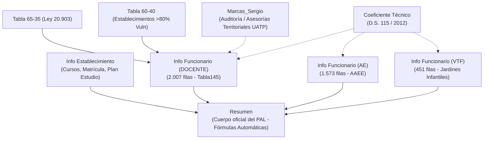

# Skill: Protocolo de Análisis y Operación de Planillas DEP (PAL & GDP)

Este skill define la arquitectura, normas de validación, fórmulas y procedimientos operativos para interactuar con las planillas oficiales emitidas y exigidas por la **Dirección de Educación Pública (DEP)** y los **Servicios Locales de Educación Pública (SLEP)**:
1. **Planilla PAL (Plan Anual Local)**: Instrumento territorial maestro consolidado para planificación de dotación docente, asistentes de la educación y VTF.
2. **Planilla GDP (Gestión de Dotación de Personal)**: Instrumento de postulación, costeo presupuestario y sanción ejecutiva por fondo de financiamiento (PIE, SEP, Subvención Normal Titular, Contrata, AAEE y Pro-Retención).

---

## 1. Planilla Maestra: PAL 2027 DEP (`Planilla final PAL 2027 DEP_15oct2026.xlsx`)

### 1.1 Estructura de Hojas y Flujo de Datos


### 1.2 Reglas Críticas por Hoja
1. **`Indicaciones`**:
   - Marco regulatorio de la DEP. La hoja `Resumen` es de solo lectura y consolida mediante `COUNTIFS` y `SUMIFS`.
   - La suma de horas de las columnas N a R en DOCENTE debe cuadrar exactamente con la Columna J (`TOTAL HRS CONTRATO`).
   - Casos especiales reglamentados:
     - **Docente Bi-nivel**: Una sola fila, seleccionar `Ed. Básica/Media` en Columna D.
     - **Docente en 2 Establecimientos**: Una fila por cada RBD donde ejerce.
     - **Docente con 2 Contratos**: Una fila por contrato individual.
     - **Docente Art. 69 Ley 19.070**: Se registra jornada completa en Columna J y se destina a horas no lectivas voluntarias.
     - **Docente Multigrado**: Registrar contrato de mayor horas o suma hasta 44 hrs.
2. **`Resumen`**:
   - Totaliza por cada RBD los cargos y horas de directivos, técnicos-pedagógicos, aula y asistentes.
   - Fórmula Directiva: `=COUNTIFS('Info Funcionario (DOCENTE)'!$C:$C,$A3,'Info Funcionario (DOCENTE)'!$G:$G,"Función Directiva")`
   - Fórmula Horas Aula: `=SUMIFS('Info Funcionario (DOCENTE)'!$J:$J,'Info Funcionario (DOCENTE)'!$C:$C,$A3,'Info Funcionario (DOCENTE)'!$G:$G,"Docente aula")`
3. **`Info Establecimiento`**:
   - Vincula nivel por nivel la matrícula proyectada, número de cursos autorizados, horas mínimas de plan de estudio con/sin JECD y demanda horaria docente.
   - Fórmula: `Hrs Total Plan Estudio = Cursos por Nivel * Hrs Plan de Estudio/semana`.
4. **`Info Funcionario (DOCENTE)`**:
   - Estructurada como tabla nativa de Excel (`Tabla145`).
   - Mecanismo de conversión Pedagógica ➔ Cronológica:
     `=IF(Tabla145[[#This Row],[Hrs BÁSICA]]+Tabla145[[#This Row],[Hrs MEDIA]]>0, VLOOKUP(Hrs_Pedagógicas, IF(Proporción="65/35",'Tabla 65-35'!$A$4:$D$47,'Tabla 60-40'!$A$4:$D$47), Col_Index, 0), 0)`
   - Desglose estricto de financiamiento:
     - **Subvención General**: Considera Horas Lectivas (Col N) y Horas No Lectivas (Col O).
     - **PIE (Col P)**: Solo horas lectivas cronológicas.
     - **SEP (Col Q)**: Solo horas lectivas cronológicas (apoyo pedagógico/talleres).
     - **Otras Funciones (Col R)**: Horas no lectivas asignadas por el establecimiento (Subv. General).
5. **`Info Funcionario (AE)`**:
   - Todos los asistentes de la educación son computados con jornada 100% lectiva (sin desglose 65/35 ni 60/40).
   - Estamentos: Administrativo, Auxiliar, Técnico, Profesional.
6. **`Info Funcionario (VTF)`**:
   - Rige para salas cuna y jardines infantiles Vía Transferencia de Fondos. 100% lectivas.
7. **`Marcas_Sergio`**:
   - Hoja de trazabilidad territorial generada tras la auditoría UATP (v50), vinculando los colegios a asesores territoriales (ej. Dionicio Flores, Camila Montecino, Javier Álvarez).

---

## 2. Planilla Operativa: GDP (`Planilla GDP.xlsx`)

### 2.1 Finalidad y Roles
La planilla GDP es el instrumento de control de gasto presupuestario y aprobación oficial de dotaciones del SLEP. Opera bajo un circuito de tres actores:
1. **Establecimiento**: Envía propuesta de horas por funcionario según necesidades pedagógicas.
2. **Unidad Técnica / Financiera (UATP / Gestión de Personas)**: Audita horas, techo legal de contrata y costos unitarios.
3. **Dirección Ejecutiva SLEP**: Emite la **"Sanción Final"** (`Aprobado`, `Aprobado parcial`, `Rechazado`, `Pendiente`) y fija las `Horas autorizadas`.

### 2.2 Estructura por Vía de Financiamiento
| Hoja | Foco Normativo | Verificadores Clave | Fórmulas Críticas |
|---|---|---|---|
| **`PIE`** | Dto. 170 (Educación Especial) | `=IF(Total_Asignar <> Horas_Solicitadas, "Revisar", "Correcto")` | Cupo máximo de horas docentes diferenciales asignado por resolución. |
| **`SEP`** | Ley 20.248 (Subv. Escolar Preferencial) | `% Inversión Propuesto = Total_Remu_Propuestas / Subvención_Mensual_Disponible` | Costo/Hora: `J9/I9`. Costo Propuesta: `Horas_Sol * Costo_Hora`. Control de tope de gasto en personal. |
| **`Subv. Normal - Titulares`** | Ley 19.070 (Estatuto Docente) | Resguardo de titularidad y continuidad de horas vigentes. | Suma de horas vigentes vs solicitadas vs autorizadas. |
| **`Subv. Normal - Contrata`** | Art. 26 DFL 1/1996 (Tope 20% Contrata) | Verificador por nivel (Párvulos, Básica, Media, Diferencial): `=IF(SUM(Horas_Sol) <> Horas_Asignar, "Revisar", "Correcto")` | Desglose por niveles para garantizar cobertura exacta del Plan de Estudios sin sobrecontratación. |
| **`Subv. Normal AA.EE`** | Ley 21.109 (Estatuto Asistentes) | Distribución por escalafón: Administrativos, Auxiliares, Técnicos, Profesionales. | Suma 2025 vs propuesta 2026 vs autorizada 2026. |
| **`Pro-Retención`** | Ley 19.873 (Retención Escolar) | Meses de contrato: `=DATEDIF(Inicio, Fin, "YM") + 1`. Costo Anual: `Remu_Mensual * Meses`. | Gasto total proyectado vs asignación presupuestaria Pro-Retención. |

---

## 3. Matriz de Auditoría y Verificación de Integridad

Al inspeccionar o procesar estas planillas, el agente debe ejecutar las siguientes 5 pruebas de integridad:

```
[TEST 1: Balance Contractual Docente PAL]
Condición: Columna J (TOTAL HRS CONTRATO) == Suma(Col N + Col O + Col P + Col Q + Col R)
Margen de tolerancia: +/- 0.05 hrs
Diagnóstico de error: Sub o sobreasignación horaria no justificada en el contrato.

[TEST 2: Balance Contractual AE]
Condición: Columna I (TOTAL HRS CONTRATO) == Suma(Col J S.Gral + Col K PIE + Col L SEP)
Margen de tolerancia: 0.00 hrs

[TEST 3: Integridad de Búsqueda VLOOKUP 65/35 y 60/40]
Riesgo: Tablas de búsqueda contienen valores duplicados de HA con distintas jornadas semanales (ej. HA=35 en fila 7 con 41 hrs y fila 8 con 40 hrs).
Regla: El VLOOKUP siempre toma el primer match; validar si la jornada resultante corresponde al contrato del docente.

[TEST 4: Conciliación Cobertura Plan de Estudios]
Condición: En 'Info Establecimiento', la suma de horas lectivas aula en DOCENTE debe cubrir al menos el 100% de 'Hrs Total Plan Estudio' (Col G) por nivel.

[TEST 5: GDP - Estados de Sanción Final]
Validación de listas desplegables:
- Estado: Aprobado, Aprobado parcial, Rechazado, Pendiente.
- Situación funcionario: Vigente, Renuncia, Pendiente, Cese, Defunción, Renuncia parcial, Cambio fondo, No asume, Sin efecto, Fallecido/a, Destinación.
```
