# Mapa de Dependencias y Acoplamiento del Sistema Dotación

**Proyecto:** Consolidador de Dotación SLEP Valle Diguillín  
**Fecha:** Septiembre 2026  

---

## 1. Grafo de Dependencias por Capas

```mermaid
graph TD
    subgraph Electron_Main [Electron Main Process]
        main_ts[electron/main.ts]
        preload_ts[electron/preload.ts]
    end

    subgraph Presentation_Layer [Capa de Presentación React]
        App_tsx[src/App.tsx]
        Header_tsx[src/components/Header.tsx]
        Modals[src/components/*Modals.tsx]
        CopilotDrawer[src/components/DotacionCopilotDrawer.tsx]
        Views[src/views/ 11 Vistas]
    end

    subgraph Application_Services [Servicios de Aplicación]
        calcService[src/services/dotacionCalculationService.ts]
        statService[src/services/estadisticasHorasService.ts]
        copilotService[src/services/dotacionCopilotService.ts]
        excelExportService[src/services/excelMatrizDotacionService.ts]
        excelReportService[src/services/excelReportService.ts]
        excelParserService[src/services/excelMatrixParserService.ts]
        sigeService[src/services/sigeParserService.ts]
        comboService[src/services/combinacionCursosService.ts]
        geminiClient[src/services/geminiApiClient.ts]
        analizador[src/services/analizador/*]
    end

    subgraph Data_Layer [Capa de Datos y Repositorios]
        dbFacade[src/database/db.ts]
        dbCore[src/database/dbCore.ts]
        schema[src/database/schema.ts]
        idbStorage[src/database/idbStorage.ts]
        repos[src/database/repositories/*.ts]
        catalog[src/data/slepSchoolsCatalog.ts]
    end

    subgraph Domain_Core [Motor Normativo Core]
        engineIndex[packages/mineduc-engine/src/index.ts]
        tablasMineduc[packages/mineduc-engine/src/tablasMineduc.ts]
        calculoJornada[packages/mineduc-engine/src/calculoJornada.ts]
        calculoMultitramo[packages/mineduc-engine/src/calculoMultitramo.ts]
        normativaPie[packages/mineduc-engine/src/normativaPieAuditor.ts]
        planesEstudio[packages/mineduc-engine/src/planesEstudio.ts]
        capacidadSae[packages/mineduc-engine/src/capacidadSae.ts]
        modalidades[packages/mineduc-engine/src/modalidades.ts]
        ley20903[packages/mineduc-engine/src/ley20903.ts]
        sobreasignacion[packages/mineduc-engine/src/sobreasignacion.ts]
    end

    %% Relaciones
    main_ts --> preload_ts
    preload_ts -.->|IPC ContextBridge| App_tsx
    preload_ts -.->|IPC net.fetch| geminiClient

    App_tsx --> Views
    App_tsx --> Header_tsx
    App_tsx --> Modals
    App_tsx --> CopilotDrawer
    App_tsx --> dbFacade
    App_tsx --> calcService
    App_tsx --> excelExportService
    App_tsx --> excelReportService

    Views --> dbFacade
    Views --> calcService
    Views --> statService
    Views --> comboService
    Views --> excelExportService
    Views --> sigeService

    calcService --> engineIndex
    statService --> engineIndex
    excelExportService --> engineIndex
    excelParserService --> catalog
    copilotService --> calcService
    copilotService --> geminiClient
    analizador --> engineIndex
    analizador --> catalog

    dbFacade --> dbCore
    dbFacade --> repos
    repos --> dbCore
    repos --> schema
    repos --> catalog
    repos --> calcService
    dbCore --> idbStorage
    dbCore --> schema

    engineIndex --> tablasMineduc
    engineIndex --> calculoJornada
    engineIndex --> calculoMultitramo
    engineIndex --> normativaPie
    engineIndex --> planesEstudio
    engineIndex --> capacidadSae
    engineIndex --> modalidades
    engineIndex --> ley20903
    engineIndex --> sobreasignacion
    calculoMultitramo --> tablasMineduc
    calculoJornada --> tablasMineduc
    sobreasignacion --> tablasMineduc
```



---

## 2. Inventario de Dependencias Externas (`package.json`)

| Paquete | Versión | Tipo | Propósito | Evaluación de Acoplamiento / Riesgo |
|---------|---------|------|-----------|-------------------------------------|
| `react` / `react-dom` | `18.3.1` | Runtime | Renderizado UI SPA y hooks de estado | Estándar de industria. Buen rendimiento con lazy loading modular. |
| `sql.js` | `1.12.0` | Runtime | Motor SQLite compilado a WebAssembly | **Pilar crítico.** Permite SQL relacional completo offline en memoria. |
| `exceljs` | `4.4.0` | Runtime | Generación de planillas Excel avanzadas con estilos | Utilizado en `excelMatrizDotacionService` y `excelMatrixParserService`. |
| `xlsx` (SheetJS) | `0.18.5` | Runtime | Parser secundario rápido de archivos Excel | Utilizado en analizador y pre-visualizaciones. |
| `file-saver` | `2.0.5` | Runtime | Descarga de archivos en entornos web fallback | Utilizado como alternativa si no está disponible Electron Save Dialog. |
| `lucide-react` | `1.16.0` | Runtime | Iconografía UI | Cero lógica de negocio. Árbol de iconos bien optimizado. |
| `clsx` / `tailwind-merge`| `^2.1.1` / `^2.5.5` | Runtime | Manejo de clases CSS condicionales | Utilidad ligera de presentación. |
| `electron` | `^33.2.1` | Dev | Shell de escritorio nativo Windows/Linux/Mac | Empaquetado standalone con ciclo de vida de ventana. |
| `electron-builder` | `^25.1.8` | Dev | Empaquetador portable para Windows | Generación de ejecutables portables `.exe`. |
| `vite` | `^6.0.3` | Dev | Bundler y servidor de desarrollo HMR | Configurado con alias limpios y compilación rápida. |
| `vitest` | `^2.1.8` | Dev | Runner de pruebas unitarias | 141 tests ejecutándose en menos de 5 segundos. |
| `tailwindcss` | `^3.4.16` | Dev | Motor de estilos utilitarios | Diseñado con paleta corporativa SLEP. |

---

## 3. Análisis de Acoplamiento y Flujo de Datos

### 3.1 Acoplamiento Muy Bajo / Deseable (Excelente)
- **`@slep/mineduc-engine`:** Cero dependencias externas (ni React, ni SQLite, ni Electron). Es una librería matemática y normativa pura en TypeScript que puede ejecutarse en Node.js, navegadores, workers o entornos backend sin modificaciones.

### 3.2 Puntos de Acoplamiento Alto (Focos de Atención para la Evolución)
1. **`src/App.tsx` como State Hub:**
   - `App.tsx` administra el estado global (`colegios`, `colegioActivo`, `salas`, `cursos`, `docentes`, `asignaciones`, `todasLasSalas`, `todosLosCursos`, etc.) y actúa como controlador orquestador de 11 vistas.
   - *Impacto:* Agregar nuevas entidades (ej: planes de financiamiento, contratos formales, escenarios simulados) satura los `props` y `handlers` pasados a cada vista.
2. **Acoplamiento Bidireccional `carteraRepo.ts` <-> `dotacionCalculationService.ts`:**
   - `carteraRepo.ts` importa `calcularDiagnosticoColegio` desde `dotacionCalculationService.ts` para computar comparativas entre periodos, mientras que los servicios importan tipos de la capa de datos.
3. **Interacción entre Analizador de Dotación y SQLite (`traspasoRepo.ts`):**
   - El módulo `services/analizador/` tiene su propio esquema de tipos (`types/analizadorTypes.ts`), el cual es transformado al esquema relacional de la aplicación en `database/repositories/traspasoRepo.ts`.

---

## 4. Frontera de Comunicación IPC (Electron <-> Renderer)

El aislamiento de contexto (`contextIsolation: true`) protege la aplicación frente a vulnerabilidades de inyección. La interfaz entre el renderer y el sistema operativo está delimitada en `electron/preload.ts`:

```typescript
window.electronAPI = {
  saveFileDialog(options): Promise<string | null>,
  openFileDialog(options): Promise<string | null>,
  writeFile(filePath, content): Promise<{ success: boolean; error?: string }>,
  readFile(filePath): Promise<{ success: boolean; data?: string; error?: string }>,
  geminiRequest(url, options): Promise<{ ok: boolean; status: number; data: string }>,
  getVersion(): Promise<string>,
  isDesktop: true
}
```

Esta separación garantiza que toda la lógica de negocio, datos relacionales y cálculos operen de manera idéntica en modo Desktop Electron o en modo Web/Cloud, facilitando cualquier transición futura.
