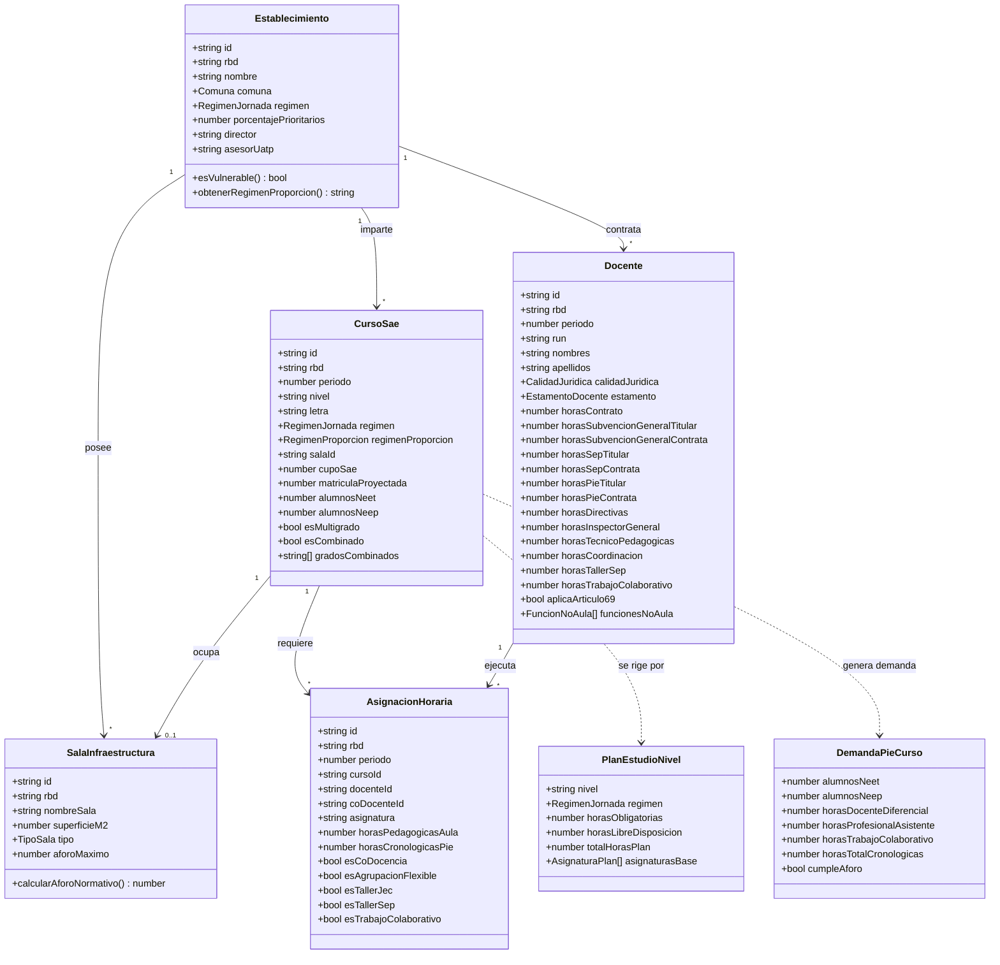

# Modelo de Dominio y Reglas Normativas del Sistema Dotación

**Dominio:** Planificación, Simulación, Optimización y Auditoría de Dotación Docente para Servicios Locales de Educación Pública (SLEP) — Chile  
**Normativas de Referencia:** Ley N° 21.040 (Nueva Educación Pública), Ley N° 20.903 (Carrera Docente y Proporción Lectiva/No Lectiva), DFL N° 1/1996 (Estatuto Docente), Decreto N° 170/2009 y Ordinario N° 2398/2023 (PIE), Decreto N° 548/1988 (Infraestructura Escolar), Ley N° 20.248 (SEP), Decreto N° 289/2010 (Jornada Escolar Completa).

---

## 1. Glosario de Términos del Dominio SLEP / MINEDUC

- **SLEP:** Servicio Local de Educación Pública. Órgano público descentralizado sostenedor de los establecimientos educacionales de su territorio.
- **UATP:** Unidad de Apoyo Técnico Pedagógico del SLEP. Responsable de la supervisión curricular, planificación y auditoría de la dotación docente.
- **RBD:** Rol Base de Datos. Identificador único nacional de cada establecimiento educacional asignado por el MINEDUC.
- **RUN:** Rol Único Nacional del docente o asistente de la educación.
- **HA (Hora Pedagógica de Aula):** Unidad lectiva de clase frente a estudiantes equivalente estrictamente a **45 minutos cronológicos**.
- **HC (Hora Cronológica):** Unidad de tiempo de 60 minutos. Las contrataciones laborales docentes se pactan en horas cronológicas semanales (1 a 44 hrs).
- **HNL (Hora / Tiempo No Lectivo):** Tiempo contractual remunerado destinado a la preparación de clases, evaluación de aprendizajes, atención de apoderados y reuniones de ciclo/departamento.
- **Recreo Normativo:** Tiempo de descanso de estudiantes y docentes imputable a la jornada contractual conforme a la tabla oficial de distribución de la Ley 20.903.
- **Régimen 65/35:** Proporción regular fijada por la Ley 20.903: máximo 65% del contrato destinado a docencia de aula (lectiva + recreos proporcionales) y mínimo 35% a actividades no lectivas.
- **Régimen 60/40:** Proporción especial fijada por la Ley 20.903 para establecimientos con **≥ 80% de concentración de alumnos prioritarios** o cursos de 1° a 4° básico y párvulos en escuelas vulnerables: máximo 60% lectivo y mínimo 40% no lectivo.
- **JEC / No JEC:** Jornada Escolar Completa Diurna (planes de estudio de mayor carga horaria semanal, ej: 38 HA en básica) vs Jornada Simple / Mañana / Tarde (30 HA en básica).
- **SAE:** Sistema de Admisión Escolar centralizado del MINEDUC.
- **SIGE:** Sistema de Información General de Estudiantes y Docentes del MINEDUC.
- **PIE (Programa de Integración Escolar):** Decreto 170/2009. Subvención especial para atención de Necesidades Educativas Especiales Transitorias (NEET) y Permanentes (NEEP).
- **SEP (Subvención Escolar Preferencial):** Ley 20.248. Recursos adicionales destinados a mejorar la equidad y calidad educativa de alumnos prioritarios y preferentes.
- **Artículo 69 (Estatuto Docente / Ley 20.903):** Derecho irrenunciable del docente con ≥ 30 años de servicio o edad de jubilación que solicita rebajar su carga de aula a un tope máximo de **24 horas cronológicas semanales** (32 HA), transfiriéndose el saldo a HNL.

---

## 2. Entidades Principales del Dominio

---

## 3. Invariantes y Reglas Normativas Inmutables

### 3.1 Aritmética de Jornada en Minutos Enteros
Toda la lógica de cálculo debe operar sobre minutos enteros para evitar errores de redondeo en planillas de pago:
$$\text{Minutos Totales de Contrato} = \text{Horas Cronológicas Semanales} \times 60$$
$$\text{Minutos Lectivos de Aula} = \text{Horas Pedagógicas de Aula (HA)} \times 45$$
$$\text{Minutos de Recreo} = \text{Tabla Oficial MINEDUC según Tramo}$$
$$\text{Minutos No Lectivos (HNL)} = \text{Minutos Contrato} - \text{Minutos Lectivos} - \text{Minutos Recreo}$$
$$\text{HNL Planificación Exclusiva} = \text{HNL} \times 0.40 \quad (40\% \text{ destinado a preparación individual})$$

### 3.2 Invariante de Fuentes de Financiamiento
Para cada docente en un establecimiento:
$$\text{Horas Contrato} = (\text{SubvGen}_{\text{Tit}} + \text{SubvGen}_{\text{Cont}}) + (\text{SEP}_{\text{Tit}} + \text{SEP}_{\text{Cont}}) + (\text{PIE}_{\text{Tit}} + \text{PIE}_{\text{Cont}})$$
No puede existir sobrefinanciamiento ni discrepancia con las horas contratadas en la resolución/decreto del SLEP.

### 3.3 Regla de Restricción Financiera SEP / PIE
- **Plan de Estudio Obligatorio:** Las horas lectivas obligatorias del currículum nacional (Lenguaje, Matemática, Ciencias, Historia, etc.) y los talleres JEC de libre disposición ordinarios **DEBEN ser financiados con Subvención General**.
- **SEP:** Solo puede financiar horas de reforzamiento pedagógico fuera del plan común, talleres extracurriculares del Plan de Mejoramiento Educativo (PME), o co-docencia de apoyo en aula regular.
- **PIE:** Solo puede financiar horas de apoyo especializado (docente diferencial, fonoaudiólogo, psicólogo) y las 3 horas cronológicas de trabajo colaborativo Art. 86.
- **Alerta de Improcedencia:** Si un docente realiza horas lectivas del Plan de Estudio ordinario pero sus horas están financiadas exclusivamente con SEP o PIE, el sistema emite una alerta financiera de improcedencia ante la Superintendencia de Educación.

### 3.4 Invariante de Sobreasignación y Artículo 69
- Ningún docente de aula puede superar las horas lectivas máximas estipuladas por la tabla oficial MINEDUC para su jornada regular base.
- Si `aplicaArticulo69 === true`:
  $$\text{Horas Cronológicas de Aula} \le 24 \text{ hrs} \iff \text{Horas Pedagógicas de Aula (HA)} \le 32 \text{ HA}$$
  Cualquier excedente sobre 32 HA se bloquea o marca como infracción normativa.

### 3.5 Invariante Territorial Multi-Escuela
$$\sum_{i \in \text{Establecimientos}} \text{Horas Contrato}_i(\text{RUN}) \le 44 \text{ hrs/semana}$$
Si un docente presta servicios en 2 o más escuelas del SLEP y la sumatoria supera 44 horas cronológicas, el Consolidador Territorial emite alerta crítica inmediata de incompatibilidad horaria del Estatuto Administrativo y Código del Trabajo.

### 3.6 Aforos Decreto 548 y Validación SAE
- **Capacidad Sala Básica/Media:** $\lfloor \text{Superficie m}^2 / 1.1 \rfloor$
- **Capacidad Sala Párvulos:** $\lfloor \text{Superficie m}^2 / 1.5 \rfloor$
- **Capacidad Talleres:** $\lfloor \text{Superficie m}^2 / 1.8 \rfloor$
- **Invariante SAE:** $\text{Matrícula Proyectada} \le \text{Aforo Físico}$ y $\text{Cupo SAE} \le \text{Aforo Físico}$.

---

## 4. Auditoría Multitramo Ponderada (Docentes Mixtos)

Cuando un docente imparte clases en cursos con **65/35** (ej. 7° Básico) y simultáneamente en cursos con **60/40** (ej. 2° Básico vulnerable), además de horas institucionales o PIE:

1. Se determinan los requerimientos mínimos de jornada independientes para cada tramo:
   $$\text{Req}_{65} = \text{buscarContratoMinimoPorTabla}(\text{HA}_{65}, '65\_35')$$
   $$\text{Req}_{60} = \text{buscarContratoMinimoPorTabla}(\text{HA}_{60}, '60\_40')$$
2. Se deduce la jornada regular base descontando funciones no aula y horas directas PIE/SEP exentas:
   $$\text{Contrato Regular Base} = \text{Contrato Real} - \text{Horas PIE} - \text{Horas Taller SEP} - \text{Horas No Aula}$$
3. Se distribuye proporcionalmente el contrato regular en $C_{65}$ y $C_{60}$:
   $$C_{65} = \text{round}\left( \text{Contrato Regular Base} \times \frac{\text{Req}_{65}}{\text{Req}_{65} + \text{Req}_{60}} \right), \quad C_{60} = \text{Contrato Regular Base} - C_{65}$$
4. Se acumulan los minutos lectivos máximos autorizados por tabla y se comparan contra los minutos reales de aula:
   $$\text{Minutos Aula Reales} = (\text{HA}_{65} + \text{HA}_{60}) \times 45$$
   $$\text{Minutos Límite} = \text{Lectivas}(C_{65}, '65\_35') + \text{Lectivas}(C_{60}, '60\_40')$$
   $$\text{Es Infractor} \iff \text{Minutos Aula Reales} > \text{Minutos Límite}$$
